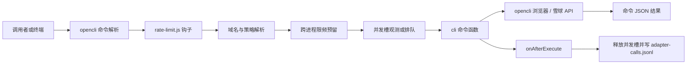

# opencli-adapters 项目与工具说明书

> 项目版本：1.2.0  
> 更新日期：2026-10-13  
> 代码基线：`main`（编写时 `6ed6c56`）  
> 适用对象：插件使用者、调用方开发者、维护者

## 1. 项目是什么

`opencli-adapters` 是装在本机 opencli 上的机器级插件，提供雪球采集命令、通用网页正文提取命令，并通过 opencli registry 钩子治理调用频率、并发观测和请求台账。它不是独立爬虫服务；页面导航、DOM 抽取和雪球 API 请求由 opencli 已连接的浏览器会话执行。

### 1.1 主要能力

| 命令 | 输入 | 结果 |
| --- | --- | --- |
| `opencli xueqiu user-articles --user_id <用户ID>` | 雪球用户 ID、期望条数、页码 | 用户动态和专栏条目，包含 `is_column` |
| `opencli xueqiu news <股票代码>` | 股票代码、条数 | 个股资讯 |
| `opencli xueqiu comments <股票代码>` | 股票代码、`--limit`（1–100） | 股票讨论动态 |
| `opencli xueqiu stock-notices <股票代码>` | 股票代码、条数（最高 100） | 个股公告；需要雪球登录态 |
| `opencli xueqiu replies <帖子URL>` | 帖子 URL、条数 | 帖子回复 |
| `opencli web article <绝对URL>` | HTTP(S) URL、正文阈值、可选 selector | 标题、Markdown 正文、命中 selector、字符数 |

小红书搜索覆盖已在 1.2.0 移除；若 opencli 提供 `xiaohongshu search`，它来自官方基线，不是本插件维护的命令。

### 1.2 结构与运行流程



- 顶层命令文件通过 `cli({...})` 注册；`rate-limit.js` 是插件中唯一注册钩子的入口。
- `lib/` 放非命令辅助模块，需由入口或命令文件导入；opencli 的 discovery 不会把 `lib/` 文件当命令扫描。
- 限频按域名共享额度。例如雪球列表命令和访问 `xueqiu.com` 的 `web article` 共用 `xueqiu` 状态；公告域名可有独立策略。

## 2. 安装、注册与第一次使用

### 2.1 环境要求

- 安装 opencli `@jackwener/opencli`，插件元数据要求版本 `>=1.8.8`；opencli 包声明 Node.js `>=20.18.1`。
- 雪球命令需要 opencli 已连接可用的 Chrome 会话；需要登录的接口先执行 `opencli auth login xueqiu` 并在浏览器中完成登录。

### 2.2 注册本地插件

在仓库根目录执行：

```bash
./install.sh
```

脚本会读取 `opencli-plugin.json` 中的插件 ID `opencli-adapters`，卸载旧 ID（如存在）、以 `file://` 安装当前目录，然后检查本插件提供的六条命令并打印 `opencli adapter status`。本地安装为符号链接，修改源码通常立即生效；首次安装或插件身份变化时才需要重新安装。

验证注册：

```bash
opencli list
opencli adapter status
opencli xueqiu comments --help
opencli web article --help
```

新增命令的基本方式是在仓库顶层新增 `<command>.js`，调用 `cli({ site, name, args, columns, func, ... })`；同时更新 README、`CONTRACT.md` 和 `install.sh` 的注册检查清单。全站钩子逻辑应放在 `rate-limit.js`，不可在多个顶层模块重复注册。

### 2.3 常用命令示例

```bash
# 资讯
opencli xueqiu news SH600519 --limit 20 -f json

# 股票讨论
opencli xueqiu comments SH600519 --limit 50 -f json

# 公告（需要登录）
opencli xueqiu stock-notices SH600519 --limit 20 -f json

# 用户动态：注意 user_id 是命名参数，不是位置参数
opencli xueqiu user-articles --user_id 4111857140 --count 20 --page 1 -f json

# 帖子回复
opencli xueqiu replies https://xueqiu.com/用户ID/帖子ID --limit 20 -f json

# 通用网页正文
opencli web article https://example.com/story -f json
```

JSON 输出通常是数组；`web article` 也返回数组，取首个元素。`content` 是正文 Markdown，不在表格 `columns` 中。所有参数细节及错误码以 `opencli <site> <command> --help` 和 [CONTRACT.md](../CONTRACT.md) 为准。

## 3. 限频配置

### 3.1 配置文件

策略文件：`~/.opencli/rate-limits.json`。没有该文件时使用代码内置策略。一个可读的示例：

```json
{
  "defaults": {
    "enabled": true,
    "min_delay_s": 3,
    "max_delay_s": 8
  },
  "sites": {
    "xueqiu": {
      "enabled": true,
      "min_delay_s": 6,
      "max_delay_s": 12,
      "long_pause_every": 30,
      "long_pause_min_s": 45,
      "long_pause_max_s": 75
    },
    "web": {
      "enabled": true,
      "min_delay_s": 6,
      "max_delay_s": 8
    },
    "*": {
      "enabled": true,
      "min_delay_s": 6,
      "max_delay_s": 10
    }
  },
  "domains": {
    "cninfo.com.cn": {
      "enabled": true,
      "min_delay_s": 6,
      "max_delay_s": 8
    }
  }
}
```

字段说明：

| 字段 | 含义 |
| --- | --- |
| `enabled` | 是否对命令限频；设为 `false` 时该调用跳过限频及并发槽登记 |
| `min_delay_s` / `max_delay_s` | 每次调用预留的随机间隔秒数；如果 `min > max`，实际间隔收敛为 `min` |
| `long_pause_every` | 每第 N 次调用增加一次长停；0 表示关闭 |
| `long_pause_min_s` / `long_pause_max_s` | 长停范围秒数 |
| `skip_commands` | 命令名白名单；命中时不节流，例如本地帮助命令 |
| `state_path` | 覆盖限频状态 JSON 文件路径 |
| `concurrency` | 同域名并发上限；缺省/0 表示只观测、不拦截 |
| `concurrency_enabled` | 显式设为 `false` 时即使填了并发上限也只观测 |

### 3.2 策略匹配和合并规则

1. `lib/domains.js` 从命令站点默认域名或 URL 参数解析实际 host，并映射成 `domain_key`。
2. 按 `domains[domain_key]` → `sites[site_key]` → `sites["*"]` 查找策略。
3. 命中策略时字段由 `defaults`、`sites["*"]`、命中的策略依次覆盖。**域名命中后不会继续合并站点策略**；域名配置缺少的字段落到 defaults，而不是站点配置。
4. 只有 `defaults`、却没有域名/站点/通配策略时，不会自动对所有未知站点启用限频。

已内置：雪球 `6–12s`，每 30 次另加 `45–75s` 长停；`web` 为 `6–8s`；小红书站点键为固定 `15s`。通过站点默认值、用户 `domains` 规则和域名键别名分流。内置最小间隔有 `6s` 的项目守卫；用户配置仍可覆盖，但应先核对消费方节奏和峰值判据。

限频采用“预留下一时隙再等到开始”的方式：进程持锁更新 `next_at` 和调用计数，立即释放锁，然后才睡眠。睡眠不占锁，因此同时等待的调用会排成间隔队列，而不是长时间持有锁。

状态默认写入 `~/.opencli/<domain_key>-throttle.json`。雪球键沿用 `xueqiu-throttle.json`，小红书沿用 `xiaohongshu-throttle.json`；随意改变域名键会换状态文件，导致已有排期失效。配置加载后在当前 Node 进程内缓存；opencli 下一次独立调用会读取新的配置。

### 3.3 环境变量

环境变量由**调用 opencli 的父进程**设置，并继承给 opencli 插件进程。用于临时覆盖或自动化部署：

| 变量 | 作用 |
| --- | --- |
| `OPENCLI_RATELIMIT_DISABLED=1` | 关闭插件的限频处理；调用会在并发登记前返回 |
| `OPENCLI_RATELIMIT_<KEY>_MIN_DELAY_SECONDS` / `...MAX_DELAY_SECONDS` | 覆盖一个域名键或站点键间隔；key 转大写，非字母数字换成 `_`，例如 `CNINFO_COM_CN` |
| `OPENCLI_RATELIMIT_MIN_DELAY_SECONDS` / `...MAX_DELAY_SECONDS` | 通用间隔覆盖 |
| `XUEQIU_OPENCLI_THROTTLE=0` | 关闭雪球键流量的限频（包括解析到雪球域名的 `web` 调用） |
| `XUEQIU_OPENCLI_MIN_DELAY_SECONDS` / `...MAX_DELAY_SECONDS` | 覆盖雪球间隔 |
| `XUEQIU_OPENCLI_LONG_PAUSE_EVERY`、`XUEQIU_OPENCLI_LONG_PAUSE_MIN_SECONDS`、`...MAX_SECONDS` | 覆盖雪球长停 |
| `XUEQIU_OPENCLI_THROTTLE_STATE` | 覆盖雪球限频状态文件路径 |
| `XUEQIU_OPENCLI_INFLIGHT_DIR` | 覆盖并发槽目录根路径，适合隔离验证 |
| `XUEQIU_OPENCLI_CONCURRENCY_WAIT_MS` | 并发排队预算，默认 20,000 ms；超预算 fail-open 放行并记 `overflowed` |
| `XUEQIU_OPENCLI_INFLIGHT_TTL_MS` | 槽过期时间，默认 240,000 ms；后续调用会回收过期槽 |
| `OPENCLI_ADAPTER_LOG=off` | 关闭插件台账；设为路径可改变台账位置 |
| `OPENCLI_RATELIMIT_DEBUG=1` + `OPENCLI_VERBOSE=1` | 输出限频等待调试信息，两个开关都需要 |
| `XUEQIU_CALL_SOURCE` | 调用方归因，写进插件台账 |
| `XUEQIU_OPENCLI_CALL_ID` | 可选关联 ID，便于和调用方台账 1:1 对账 |

例：

```bash
XUEQIU_CALL_SOURCE=xueqiu-monitor/manual \
OPENCLI_RATELIMIT_XUEQIU_MIN_DELAY_SECONDS=8 \
opencli xueqiu news SH600519 -f json
```

开关取值规则：`OPENCLI_RATELIMIT_DISABLED` 为真值时表示关闭；`XUEQIU_OPENCLI_THROTTLE` 使用 `0`、`false`、`off`、`no`、`disabled` 等假值关闭。不要同时启用旧 Python 限速器和插件限速器，否则会双重等待；如切回旧实现，按 README 指引同时关闭插件限速。

## 4. 并发控制

频率和并发控制的是不同维度：**限频控制请求开始时间间隔**；并发闸控制同一 `domain_key` 下同时执行的命令数。

### 4.1 默认观测模式

内置配置不设置 `concurrency`。当前行为是：正常创建/释放槽并记录实时在飞数，但不等待、不阻止。这是有意的观测阶段，不代表限流上限已经生效。

### 4.2 开启上限

可以在域名或站点策略中设置上限：

```json
{
  "domains": {
    "xueqiu": {
      "enabled": true,
      "min_delay_s": 6,
      "max_delay_s": 12,
      "long_pause_every": 30,
      "long_pause_min_s": 45,
      "long_pause_max_s": 75,
      "concurrency": 2,
      "concurrency_enabled": true
    }
  }
}
```

同一 domain 下到达上限时，后续命令以约 200–400 ms 随机间隔轮询，最长等待 `XUEQIU_OPENCLI_CONCURRENCY_WAIT_MS`（默认 20 秒）；预算耗尽就 fail-open 继续执行，并在台账标记 `overflowed: true`。目录、锁等基础设施失败也 fail-open，并用 `gate_fail_open: true` 区别记录。

槽位文件位于 `~/.opencli/inflight/<domain_key>/<token>.slot`，槽包含 pid、命令、开始时间、过期时间等。命令成功或报错时 `onAfterExecute` 释放槽；被 KILL 的进程无法释放，过期槽由后续调用清扫。不要把 `XUEQIU_OPENCLI_INFLIGHT_TTL_MS` 设得短于可能的命令执行时间，否则运行中的槽会被误回收。

### 4.3 调用方超时预算

等待都发生在 opencli 子进程里，会计入调用方的 `subprocess` 超时。仓内说明估算：限频最长约 87 秒（最长长停 75 秒 + 间隔 12 秒）+ 锁等待 2 秒 + 并发等待预算 20 秒 + 实际执行时间约 10 秒，已经接近 120 秒。因此启用并发排队前，相关调用方超时应从当前 120 秒提高到约 150 秒，并同步检查调用链上的外层任务超时。

## 5. 调用方集成、请求覆盖面和台账

### 5.1 调用方如何配置

策略文件适合统一配置本机行为；父进程环境变量适合给具体来源打标签或临时覆盖。Python 调用时应把环境传给 `subprocess`：

```python
import os
import subprocess

env = os.environ.copy()
env["XUEQIU_CALL_SOURCE"] = "xueqiu-monitor/manual"
env["XUEQIU_OPENCLI_CALL_ID"] = "run-20261013-001"
proc = subprocess.run(
    ["opencli", "xueqiu", "news", "SH600519", "-f", "json"],
    env=env,
    capture_output=True,
    text=True,
    timeout=120,
)
```

示例只演示归因；若本地启用了并发门，必须按上一节同步增加 `timeout`。消费者仓中有共享调用封装，改它会影响多个项目，详见 `CONTRACT.md` 消费者表。

### 5.2 控制覆盖边界

| 调用通道 | 本插件钩子/限频/并发/插件台账 |
| --- | --- |
| 本插件和官方基线的 registry `cli()` 命令 | 覆盖 |
| `opencli browser …` | 不覆盖；它绕过 registry 钩子 |
| `opencli list`、`doctor`、帮助等本地探测 | 不覆盖 |
| curl、urllib、playwright、nodriver 等直接访问 | 不覆盖 |
| monitor 直接抓公告 PDF 等站外通道 | 不覆盖 |

所以“开了插件限频”不等于所有浏览器或所有网络请求都受限；排查域名调用密度时要把这些旁路一起纳入。

### 5.3 两份调用台账

| 文件 | 写入者 | 内容 |
| --- | --- | --- |
| `~/.opencli/adapter-calls.jsonl` | 插件 | domain、等待时长、限频跳过原因、并发数、fail-open 状态、命令结果；默认轮转为 `.1` |
| `~/.opencli/xueqiu-calls.jsonl` | Python 调用方 | 调用意图、调用者、预期 miss、stderr 摘要，也能记录插件看不到的 `browser:*` 调用 |

关联优先使用 `XUEQIU_OPENCLI_CALL_ID`；否则可结合插件记录的 `ppid` 和时间。插件台账写入失败会被吞掉，避免影响命令。台账通常有助排查，但当前会记录命令参数和目标 URL；URL 可能带敏感查询值，避免将凭证放进 URL，并注意本机日志访问权限和保留策略。

## 6. 每个运行时代码函数说明

本节覆盖仓库自有运行时代码中的具名函数、命令处理器和重要内嵌页面脚本；第三方 `node_modules` 中的函数不属于本项目源码。异步回调、数组 `map/filter` 回调和 MutationObserver 回调在它所属的父函数条目中说明。

### 6.1 命令模块

#### `article.js` — `web article`

| 函数/脚本 | 说明 |
| --- | --- |
| `buildCloneHtmlJs(selector)` | 构造要在浏览器页面执行的脚本：选择正文容器、深拷贝 DOM、移除脚本/导航/表单等噪声节点和事件/样式/data 属性，再返回清理后的 HTML。 |
| `cli(...).func(page, kwargs)` | 校验绝对 HTTP(S) URL，执行网页导航和 WAF 检查；按 selector 链提取内容并转 Markdown。正文达到 `min-chars` 后停止继续尝试更宽容器；`body` 只作最后兜底。 |
| `READ_TITLE_JS` | 浏览器 IIFE，读取 `document.title`。 |
| `BLOCK_GUARD` | 浏览器 IIFE，检查标题和正文开头是否匹配风控/验证页短语，命中后命令抛 `BLOCKED_WAF`。 |
| `buildCloneHtmlJs` 内部 DOM 遍历 | `querySelector` 选 root，克隆后按 drop 清单删除节点，TreeWalker 遍历元素并剥离危险/噪声属性。 |

#### `news.js` — `xueqiu news`

| 函数/脚本 | 说明 |
| --- | --- |
| `buildExtractJs(targetCount, maxScrolls)` | 生成新闻页滚动及卡片抽取脚本；用 MutationObserver 等待新内容，解析文章 ID、标题、文本、来源和时间，并构造雪球链接。 |
| `CLICK_NEWS_TAB_JS` | 浏览器 IIFE，查找“资讯/新闻”文字叶子节点并点击；内部 `find` 回调负责精确匹配标签。 |
| `cli(...).func(page, kwargs)` | 校验并规范股票代码，打开雪球行情页、识别风控、点击资讯标签、滚动抓取并将结果限制到 `limit`。 |
| `buildExtractJs` 内部 `countItems` / `toNumber` | 统计页面新闻卡片数；把 likes 等“万/亿”数值文本转为整数。 |
| `BLOCK_GUARD` | 浏览器风控页检测 IIFE；命中时当前命令用 `CommandExecutionError` 报告。 |

#### `comments.js` — `xueqiu comments`

| 函数 | 说明 |
| --- | --- |
| `getCommentList(json)` | 从雪球响应根对象或 `data` 子对象提取 `list` 数组。 |
| `isAntiBotHtml(response, envelopeText)` | 判断 HTML 响应是否含 captcha、challenge、WAF 等反爬特征。 |
| `toFiniteCount(value)` | 将互动数转换为有限数字；无效值回落为 0。 |
| `normalizeIdentifier(value)` | 将字符串或有限数字 ID 统一成字符串，其他值变为空串。 |
| `buildPaginationStopMessage(...)` | 构造分页提前停止的诊断说明。 |
| `throwFirstPageFailure(kind, symbol)` | 把第一页的 auth、anti-bot、argument、empty 等分类映射成契约错误类型并抛出。 |
| `getCommentItems(json)` | 安全地从可识别响应中返回对象数组；不可识别响应给空数组。 |
| `classifyXueqiuCommentsResponse(response)` | 综合 HTTP 状态、Content-Type、JSON envelope 和文本，将响应分成 auth、anti-bot、argument、empty、incompatible 或 unknown。 |
| `mergeUniqueCommentRows(current, incoming)` | 按 row ID 合并并去重，保留第一次出现的顺序；供复用/测试的纯函数。 |
| `normalizeCommentItem(item)` | 将雪球原始讨论对象转成插件内部标准行，清理文本、转换互动数、格式化时间并生成帖子 URL。 |
| `toCommentOutputRow(row)` | 删除内部 ID 字段，形成对外命令行输出字段。 |
| `describeFailureKind(kind)` | 将分类键转换成短诊断语句。 |
| `fetchCommentsPage(page, symbol, pageNumber, pageSize)` | 在已有雪球浏览器上下文内 fetch 讨论接口，带 cookie，并返回结构化状态、JSON 和文本摘要。 |
| `collectCommentRows(options)` | 控制分页、分类失败、首屏错误、后续部分失败告警、ID 去重、条数上限和安全分页次数。 |
| `normalizeSymbolInput(raw)` | 去空白、大写并校验代码格式；禁止把 URL 当股票代码。 |
| `cli(...).func(page, args)` | 校验 `limit`（正整数且不高于 100），导航到雪球建立会话，然后调用 `collectCommentRows` 并输出公共字段。 |
| `fetchCommentsPage` 内嵌 async IIFE | 在 Chrome 页面执行 `fetch`，保留站点 cookie；捕获网络异常并序列化返回，供 Node 侧分类。 |

错误分类很重要：第一页 auth/反爬/空结果会抛对应错误；分页中途失败会保留已取结果并警告，避免丢失部分数据。

#### `stock-notices.js` — `xueqiu stock-notices`

| 函数 | 说明 |
| --- | --- |
| `normalizeSymbolInput(raw)` | 规范并校验股票代码；6 位代码按交易所补 SH/SZ/BJ，4–5 位数字左侧补零；拒绝 URL。 |
| `stripHtml(html)` | 去除公告 HTML 标签、实体和模板噪声，压缩空白。 |
| `firstLink(html)` | 从公告 HTML 中抽取第一个绝对 HTTP(S) 链接。 |
| `cli(...).func(page, kwargs)` | 打开雪球建立登录态，按 10 条分页请求公告 JSON，清理字段、转换日期、最多返回 100 条；无公告时抛 `EmptyResultError`。 |
| `forEach` 条目回调 | 将每条原始公告描述映射成标题、类别、时间和链接。 |

#### `user-articles.js` — `xueqiu user-articles`

| 函数/脚本 | 说明 |
| --- | --- |
| `buildExtractJs(userId, targetCount, maxScrolls)` | 生成动态用户主页滚动和抽取脚本，识别动态 ID、作者、正文、时间、互动数、专栏标志并构造 URL。 |
| `cli(...).func(page, kwargs)` | 校验纯数字用户 ID，计算滚动目标和安全滚动次数，打开主页、检测风控、执行抽取并按 `count * page` 截取。 |
| 页面内 `countItems` | 统计动态卡片数，判断是否达到目标。 |
| 页面内 MutationObserver 回调 | 等待 DOM 高度或条目数量变化；有变化时短暂等候，无变化时由定时器结束本轮等待。 |
| 页面内 `toNumber(raw)` | 把普通数值及“万/亿”互动数转换为整数。 |
| 页面内卡片遍历回调 | 读取单条动态各字段并加入结果数组。 |
| `BLOCK_GUARD` | 页面 IIFE 检查雪球验证/风控文案。 |

#### `replies.js` — `xueqiu replies`

| 函数/脚本 | 说明 |
| --- | --- |
| `buildExtractJs(targetCount, maxScrolls)` | 生成回复区滚动和抽取脚本，解析回复 ID、作者、文本、点赞、时间和回复对象。 |
| `cli(...).func(page, kwargs)` | 从输入帖子 URL 提取数字用户/帖子 ID，规范成雪球帖子 URL，检测风控并抓取至多 `limit` 条回复。 |
| 页面内 `items` | 统计回复卡片数量，协助判断是否继续滚动。 |
| 页面内 MutationObserver 回调 | 等待懒加载回复卡片出现，或由最长等待定时器结束。 |
| 页面内 `toNumber(raw)` | 将“万/亿”点赞文本转为整数。 |
| 页面内卡片遍历回调 | 去重并把 DOM 回复卡片映射成输出行。 |
| `BLOCK_GUARD` | 检查页面是否被雪球风控拦截。 |

#### `utils.js` — 共享雪球工具

| 函数 | 说明 |
| --- | --- |
| `formatChinaDate(ts)` | 将 Unix 毫秒时间戳格式化为上海时区 `YYYY-MM-DD`；空值返回 null。 |
| `stripHtml(html)` | 基础 HTML 标签和常见实体清理，供共享调用；不等同于 DOM 解析器。 |
| `fetchXueqiuJson(page, url)` | 在已打开雪球页面内带凭证请求 JSON；401/403 抛 `AuthRequiredError`，JSON 解析失败或 HTTP 错误抛 `CommandExecutionError`。 |
| 内嵌 async IIFE | 在浏览器中执行 fetch 和 JSON parse，把错误压成可跨 CDP 返回的对象。 |

### 6.2 全局治理入口 `rate-limit.js`

| 函数 | 说明 |
| --- | --- |
| `callIdentity(ctx, guard)` | 生成调用身份和时间字段，包括 caller、pid/ppid、命令、域名键、目标和参数。 |
| `safeArgsJson(args)` | 去掉 opencli 内部参数键，序列化并截断参数；失败时返回 null。 |
| `guardFields(guard)` | 把限频等待、长停、并发观测/执行、fail-open 标志整理为台账字段。 |
| `outcomeFields(ctx)` | 依据 hook context 的错误生成 `ok`、错误码、错误文本。 |
| `buildRecord(ctx)` | 合并调用身份、治理结果和命令结果，形成一条 schema 2 插件台账记录。 |
| `installRateLimit()` | 注册 `onBeforeExecute` 和 `onAfterExecute`：前者解析域名和策略、限频、登记并发槽；后者释放槽并写台账。模块载入时立即调用一次。 |
| `onBeforeExecute` 回调 | 忽略不可识别的命令；将 guard 信息挂在 ctx；无策略、禁用或帮助命令时记录跳过原因；否则先限频等待，再登记并发。限频异常由 opencli hook fail-open，错误仍尽量写入台账。 |
| `onAfterExecute` 回调 | 仅处理登记过的调用，先释放并发槽再写记录；成功和命令报错后都能收尾。 |
| `guardFields` 内部 `ms(seconds)` | 将秒数转换为毫秒，供日志统一使用。 |

### 6.3 限速策略 `lib/policy.js`

| 函数 | 说明 |
| --- | --- |
| `loadConfig()` | 读取并缓存 `~/.opencli/rate-limits.json`，组合内置 defaults、站点表、域名表和 wildcard。解析错误时警告并退回默认配置。 |
| `explicitPolicy(key)` | 按域名策略优先、站点策略次之查询一个键。 |
| `policyForCall(domainKey, siteKey)` | 依次尝试域名、站点、wildcard 策略；找到后按 defaults→wildcard→命中项合并，无策略返回 null。 |
| `applyEnv(key, base, siteKey)` | 把全局禁用、雪球专用开关/参数和通用域名/站点间隔变量应用到配置。 |
| `shouldThrottle(name, args, policy)` | 策略关闭、命令在 skip list、参数是 help 时返回 false，否则限频。 |
| `applyEnv` 内部 `upperOf(k)` | 将策略键转成环境变量后缀格式。 |
| `applyEnv` 内部 `names(suffix)` | 生成 domain、site 和通用间隔变量名，并按优先顺序供 `envNumber` 读取。 |

### 6.4 域名解析 `lib/domains.js` 与 `domain-tables.js`

| 函数 | 说明 |
| --- | --- |
| `urlFromArgs(args)` | 优先读取 `args.url`，再扫其他字符串参数，找第一个 HTTP(S) URL。 |
| `canonicalFor(hostname)` | 按主机名后缀逐级匹配别名和明确域名规则；未知 host 使用完整 hostname，避免错误合并不同站点。 |
| `resolveDomainKey(site, args)` | 优先用站点默认 host，否则从参数 URL 解析；返回 `key`、`host`、解析来源 `via` 和是否降级 `degraded`。通用 `web` 解析失败会标记 degraded。 |
| `domain-tables.js` 常量 | `SITE_DEFAULT_DOMAIN` 定义固定站点 host；`CANONICAL_DOMAIN_KEY` 保持旧状态键兼容；`DOMAIN_RULES` 归并 cninfo、hkexnews 等多子域。 |

### 6.5 文件锁与限频 `lib/lockfile.js`、`lib/ratelimit.js`

| 函数 | 说明 |
| --- | --- |
| `readState(statePath)` | 安全读取限频 JSON；新文件或损坏文件回落到 `{ next_at: 0, calls: 0 }`。 |
| `writeState(statePath, state)` | 写入临时文件再 rename，避免读到半截 JSON；临时名含进程 PID。 |
| `newLockToken()` | 生成进程/时间/随机数组成的锁所有权凭证。 |
| `acquireLock(label, lockPath, lockToken)` | 通过 `open(..., 'wx')` 原子创建锁，轮询等待；锁超过 60 秒尝试回收；2 秒仍无法取锁或无法创建时 fail-open。 |
| `releaseLock(fd, lockPath, lockToken)` | 关闭 fd，只有读取到自己凭证或空文件才删除锁路径。锁回收是跨进程关键区，应注意陈旧回收边界。 |
| `acquireSlot(key, source, policy)` | 限频核心：在锁内读取/更新 `next_at`、计数和长停，释放锁后等待到预留时间；返回本次等待、预留、长停和 fail-open 状态。 |
| `acquireSlot` 内部长停计算 | 当调用次数是 `long_pause_every` 的整数倍时，额外抽取配置范围内的长停。 |

### 6.6 并发槽 `lib/concurrency.js`

| 函数 | 说明 |
| --- | --- |
| `inflightRoot()` | 取 `XUEQIU_OPENCLI_INFLIGHT_DIR` 覆盖路径或默认 `~/.opencli/inflight`。 |
| `ttlMs()` | 读取并发槽 TTL 环境变量，缺省 240 秒。 |
| `waitBudgetMs()` | 读取并发排队预算，缺省 20 秒。 |
| `readSlots(dir)` | 读取该域的 `.slot` 文件，剔除格式损坏/过期槽并返回有效槽元数据。 |
| `reserveOnce(options)` | 在 gate 锁中清点活跃槽；观测模式或未超限时创建新槽，超限时返回当前数量。 |
| `result(options)` | 统一构造并发结果对象，标明上限、是否强制执行、排队时间、是否拿到槽及 fail-open 原因。 |
| `acquireInflight(key, policy, meta)` | 创建域目录并循环尝试占槽；超限时有界等待，超过预算 fail-open 并标记 `overflowed`；拿锁/建目录失败标记 `gate_fail_open`。 |
| `releaseInflight(key, token)` | 校验槽文件 token 后释放自己占用的槽；无 token/槽已回收时安全返回。 |

### 6.7 台账 `lib/requestlog.js`

| 函数 | 说明 |
| --- | --- |
| `logPath()` | 解析默认台账位置、`OPENCLI_ADAPTER_LOG` 自定义路径或 off 开关。 |
| `truncate(value, max)` | 将值转字符串并截断到指定长度。 |
| `callerInfo()` | 从 `XUEQIU_CALL_SOURCE` 推断 crawler/monitor/analyzer/other/manual。 |
| `maybeRotate(target)` | 台账超过 32 MiB 时抢轮转锁，将当前文件原子改名为 `.1`；失败不阻断追加。 |
| `appendRecord(record)` | 限制每行不超过 4 KiB，必要时降级字段；创建父目录，以追加模式写单行；任何日志故障都不影响命令。 |
| `stripInternalArgs(args)` | 移除 opencli 内部键（键名以 `__` 开头），返回公开参数对象。 |
| `pickTarget(args)` | 优先返回 URL，其次 symbol/user_id/query 等常用定位值，用于日志快速识别目标。 |
| `appendRecord` 的异步轮转回调 | 异步尝试轮转，不等待轮转完成；错误被吞掉以保证日志写入不影响抓取。 |

### 6.8 环境、路径和纯工具函数

| 文件/函数 | 说明 |
| --- | --- |
| `envFlagOn(names)` | 将环境变量中非空且不属于否定值的值解析为 true，适用于 `*_DISABLED` 语义。 |
| `envFlagOff(names)` | 值为 `0/false/off/no/disabled` 时返回 true，适用于 `*_THROTTLE` 等开关。 |
| `envNumber(names, fallback)` | 按变量名优先级返回第一个有限、非负数字，否则使用 fallback。 |
| `statePathFor(key, policy)` | 解析 `policy.state_path`、雪球专用环境覆盖或默认限频状态文件路径。 |
| `sleep(ms)` | 用 Promise 包装定时器，供限频和并发轮询等待。 |
| `randomBetween(min, max)` | 在区间内生成随机间隔；若 min 大于 max，以 min 为实际间隔，确保下限不被突破。 |
| `asNumber(value, fallback)` | 安全数值转换；非有限值返回 fallback。 |
| `normalizeXueqiuSymbol(symbol)` | 6 位 A 股代码补市场前缀：920/4/8 等北交所代码为 BJ，沪市段为 SH，深市段为 SZ；其他代码原样返回。 |

### 6.9 维护工具脚本函数

| 文件/函数 | 说明 |
| --- | --- |
| `scripts/sync_waf_patterns.py:rewrite_line(line, patterns)` | 只替换 adapter `BLOCK_GUARD` 正则内容，不改变同一行其他文本。 |
| `sync_file(path, patterns)` | 就地同步一个适配器文件的 WAF 模式，返回是否改动。 |
| `check_file(path, patterns)` | 检查一个文件是否与唯一 WAF 规则源漂移，返回问题列表。 |
| `main(argv)` | 支持 `--check` 校验或默认同步四个适配器文件，输出结果并返回进程码。 |
| `install.sh:site_block()` | 从 `opencli list` 输出中抽取指定站点块，供安装脚本核验命令是否注册。 |

## 7. 测试和维护方式

### 7.1 测试清单（测试函数说明）

| 测试文件 / 函数 | 核验内容 |
| --- | --- |
| `test_plugin_policy.py:plugin_source()` | 拼接顶层 JS 与 `lib/` 源码供静态检查。 |
| `_plugin_policy_js(site)` | 从源码提取指定站点的内置策略。 |
| `_plugin_number(site, key)` | 读取策略中的数字字段。 |
| `_plugin_const_ms(name)` | 读取毫秒常量并换算成秒。 |
| `_plugin_worst_wait_seconds(site)` | 计算锁等待、节流间隔和长停组成的最坏等待。 |
| `test_builtin_sites_declare_web_with_pacing()` | 确保 `web` 内置有间隔且下限不低于 6 秒。 |
| `test_known_domains_alias_back_to_their_existing_keys()` | 确保雪球/小红书域名继续归到已有状态键。 |
| `test_concurrency_gate_defaults_to_observe_only()` | 防止未经调用方超时配套就默认开启并发阻塞。 |
| `test_opencli_adapter_domains.py:_run_probe(cases)` | 调 node 实际执行域名解析器并返回结构化结果。 |
| `test_resolve_domain_key_maps_each_case_to_the_expected_key()` | 覆盖子域、别名、多级公共后缀、冒名域和 IP。 |
| `test_web_calls_without_a_domain_are_flagged_degraded()` | 确保 web 无法解析域名时明确标 degraded。 |
| `test_opencli_adapter_symbols.py:_run(symbols)` | 调 node 执行股票代码归一化器。 |
| `test_symbol_prefix_matches_the_exchange_segments()` | 核验沪深北交所代码段、ETF 和非 A 股输入。 |
| `test_beijing_exchange_is_never_labelled_sh_or_sz()` | 单独保护北交所代码归类。 |
| `test_opencli_adapter_plugin_integrity.py:_plugin_files()` | 定位插件 JS 文件集合。 |
| `test_every_exported_name_resolves()` | 检查导出名称有效，避免插件模块加载失败。 |
| `test_relative_imports_point_at_existing_files()` | 检查本地 import 目标存在。 |
| `test_only_the_entry_registers_hooks_and_keeps_discovery_marker()` | 确保只有 rate-limit 入口注册钩子且保留 discovery 标记。 |
| `test_lib_modules_are_referenced_by_the_entry()` | 防止 `lib/` 辅助模块成为无人导入的死代码。 |
| `test_plugin_and_node_package_id_and_version_match()` | 检查插件 ID 和版本与 package 元信息一致。 |
| `test_waf_patterns_sync.py:test_block_guard_matches_analyzer_patterns()` | 确保命令风控正则与唯一规则源一致。 |
| `test_block_guard_covers_every_pattern()` | 确保每个来源模式都出现在应同步的文件中。 |

### 7.2 本地质量门

```bash
ruff check .
ruff format --check .
python3 scripts/sync_waf_patterns.py --check
python3 -m pytest tests/ -q
```

脚本语法可用 `node --check` 检查。`./check-drift.sh` 用于 opencli 升级后比较本插件与官方基线；它是人工漂移检查，不等同于运行时冒烟测试。

### 7.3 运行期检查

- `opencli list`：看命令发现结果。
- `opencli adapter status`：看插件安装来源和状态。
- `~/.opencli/adapter-calls.jsonl`：看插件 hook 决策、等待和结果。
- `~/.opencli/<domain_key>-throttle.json`：看调用计数及下一次预留开始时刻。
- `~/.opencli/inflight/<domain_key>/`：看当前并发槽。正常完成会删除，残留槽在过期后由后续调用清扫。
- `OPENCLI_RATELIMIT_DEBUG=1 OPENCLI_VERBOSE=1`：观察限频等待日志。

## 8. 错误、容错与重要边界

### 8.1 常见错误语义

| 错误类/码 | 典型含义 | 调用方建议 |
| --- | --- | --- |
| `ArgumentError` / `ARGUMENT` | 输入 URL、股票代码或 limit 不合法 | 修正参数，不重试原参数 |
| `AuthRequiredError` / `AUTH_REQUIRED` | 未登录或权限不足 | 先登录/人工解除验证 |
| `EmptyResultError` / `EMPTY_RESULT` | 接口成功但没有数据 | 不应按抓取故障不断重试 |
| `CliError('BLOCKED_WAF', ...)` | `web article` 命中风控页 | 不重试同一请求；人工处理验证或走业务回退 |
| `CommandExecutionError` / `COMMAND_EXEC` | 页面/响应异常 | 按调用方策略有限重试 |
| 锁或并发基础设施错误 | 限速/并发状态无法可靠更新 | 当前设计 fail-open 放行；检查台账中的 `rate_fail_open` 或 `gate_fail_open` |

不同雪球命令对风控错误码的使用不完全一致；具体消费方应按 `CONTRACT.md` 对应命令条目判断。

### 8.2 输出契约

opencli 命令的 stdout 被消费者当作 JSON，因此插件不能向 stdout/stderr 打普通日志。诊断写入 opencli logger 或本地 JSONL 台账。输出字段、字段类型和错误码是消费者契约；改动前先检查 `CONTRACT.md` 的消费者依赖与改动检查表。

### 8.3 fail-open 的含义

限频状态写盘失败、锁超时、并发槽目录不可用或并发等待超过预算时，设计优先让采集命令继续运行，而不是阻止整个采集链。代价是这些情况下真实限频/并发上限可能暂时失效，因此需要检查台账的 fail-open 字段，而不能只看命令是否成功。

## 9. 文件导航

| 路径 | 作用 |
| --- | --- |
| `article.js`、`news.js`、`comments.js`、`stock-notices.js`、`user-articles.js`、`replies.js` | registry 命令适配器 |
| `rate-limit.js` | 全站钩子入口、生命周期和请求记录组合 |
| `lib/policy.js`、`lib/domains.js`、`lib/domain-tables.js` | 策略加载、域名归属和解析 |
| `lib/ratelimit.js`、`lib/concurrency.js`、`lib/lockfile.js` | 文件状态锁、限频队列、并发槽 |
| `lib/requestlog.js` | 插件请求 JSONL 台账 |
| `lib/env.js`、`lib/paths.js`、`lib/util.js`、`lib/xueqiu-symbol.js` | 环境变量、路径、基础函数、股票代码归一化 |
| `utils.js` | 公告 API、日期和 HTML 工具 |
| `scripts/sync_waf_patterns.py` | 从 analyzer 的唯一 WAF 源同步模式 |
| `tests/` | 域名、股票代码、插件完整性、策略和 WAF 同步守卫 |
| `README.md` | 设计背景、配置摘要、安装与漂移检查 |
| `CONTRACT.md` | 对消费者稳定的命令/字段/错误码契约 |

